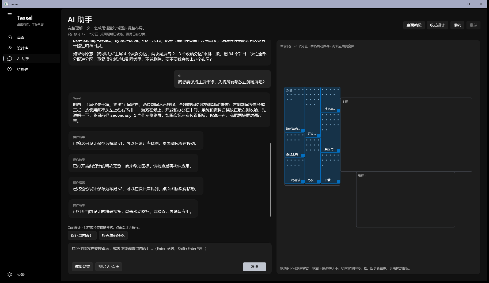
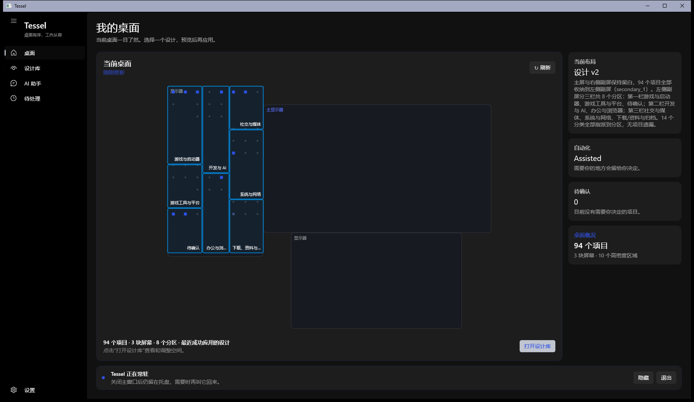
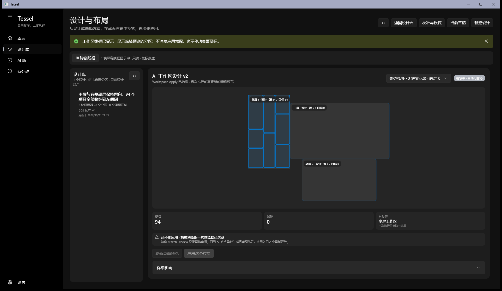
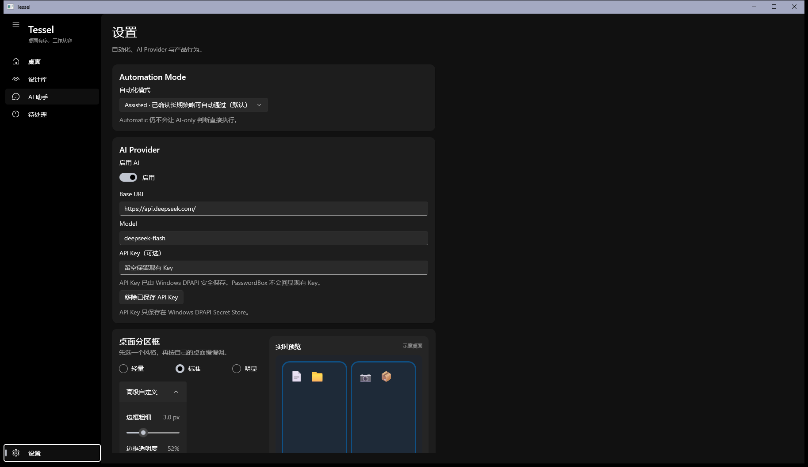

# Tessel

**对 AI 说一句话，它把你的桌面按语义分区摆好；不满意，一键撤销。**

桌面上几十个快捷方式混在一起，找东西全靠扫视——Tessel 不接管 Explorer，而是理解每个图标
是干什么的，把它们摆进有名字的分区，并且在你同意之前一步都不动。

## 三步开始用

1. **安装** —— 下载 `Tessel-Setup-1.0.0.exe` 双击即可，装到当前用户目录，不需要管理员权限。
2. **校准** —— 首次启动要求校准全部显示器的桌面网格。Tessel 会临时创建并移动专用测试图标
   来测量真实网格，这一步需要你单独确认；取消或失败都不会跳过。
3. **说话** —— 在校准完成后进入 AI 助手，描述你想要的桌面：
   > 我想保持主屏干净，其它的都放到左侧副屏吧。

   它会先给出一份设计（分区、每个分区放什么、跨屏怎么摆），你看过再决定要不要落到真桌面。

## 它能做什么

### 对话式设计，不是填表

理解一次桌面之后，后续都用轻量对话调整。设计过程实时画在右侧拓扑上：
三块屏、几个分区、每块屏上占多少位置，改一句就更新一次。

### 先预览，再决定

每条设计都能生成**精确预览**：这次要移动几项、保持几项、目标在哪块屏。预览用的是你桌面的
真实网格与真实坐标，不是估算。看完预览再点应用，才会发生写入。

### 每次应用前都有检查点

应用之前会保存一次完整的安全检查点。摆得不对，点「撤销上次整理」就能回到应用之前的样子；
如果桌面在这期间被你自己改过，它会停下来告诉你，而不是盲目回退。

### 设计库：好用就存下来

满意的设计可以存进设计库，按版本保留、随时调出来重新预览。用不上的设计可以删除——只是从
库里移除，历史版本仍在本地，桌面图标也不会因此移动。

### 分区线框画在真桌面上

把设计的分区直接描在你的真桌面上（鼠标穿透，不会挡操作），四种粗细/透明度可调，改设置当场
生效。摆之前先看一眼分区落在哪，比对着面板想象靠谱。

## 为什么可以放心用

| 原则 | 具体表现 |
| --- | --- |
| **不碰系统桌面** | 不接管 Explorer，不改系统设置，只移动用户图标；回收站等系统项默认不动 |
| **AI 只提议，不动手** | 模型输出的是设计草稿；预览、写入、撤销各走独立的安全检查，AI 无法直接指挥写入 |
| **失败就停** | 任何一步校验不一致（桌面变了、校准失效、目标不在范围内）都拒绝执行，而不是"尽力而为" |
| **数据在本地** | 设计、会话、检查点都存在本地 SQLite；API Key 放 Windows DPAPI，不落明文 |
| **每次写入可回退** | 安全检查点 + 一键撤销，撤销本身也复用同一条受控执行链 |

## 安装、数据与卸载

**安装**：`Tessel-Setup-<版本>.exe`（安装器，默认 `%LOCALAPPDATA%\Programs\Tessel`，无需管理员），
或 `Tessel-<版本>-win-x64.zip`（绿色包，解压即用）。

**数据放在哪**：

| 内容 | 路径 |
| --- | --- |
| 数据库（设计、会话、恢复检查点） | `%LOCALAPPDATA%\Tessel\desktop-agent.db` |
| 设置与外观 | `%LOCALAPPDATA%\Tessel\settings.json` |
| 校准事实 | `%LOCALAPPDATA%\Tessel\grid-calibration-environment.json` |
| 当前设计草稿 | `%LOCALAPPDATA%\Tessel\workspace-session.json` |
| API Key | Windows DPAPI Secret Store（不落明文） |

从旧版本升级时数据目录不变，直接覆盖安装即可。

**卸载**：设置 → 应用 → 已安装的应用 → Tessel → 卸载，或运行安装目录下的 `unins000.exe`。
卸载只删除程序本体，`%LOCALAPPDATA%\Tessel` 下的数据会保留；确认不再需要时手动删除该目录。

## 已知限制

- **无人值守自动执行未启用。** 引擎、安全门与「记住这块屏」授权都在代码里，但产品默认只到
  「建议 / 协助」级别；开启属于实验特性，需要显式验收钥匙，本轮未纳入发布形态。
- 只有 **x64** 构建，没有 arm64。
- 没有自动更新；升级方式是重新运行新版安装器覆盖安装。
- 校准必须在**当前显示环境下**完成；之后改了分辨率、缩放、显示排列或任务栏位置，需要重新校准。
- 界面与真机验收在 Windows 11 三屏环境完成，其他多屏组合尚未逐一验收。
- 极少数情况下「应用到桌面」可能让进程异常退出（`0xc000027b`）。应用前已保存安全检查点，
  桌面写入是 fail-closed 的；遇到请反馈 `%TEMP%\tessel-product-crash.log`。

## 给开发者

技术选型、项目结构、本地运行、构建打包、安全原则与里程碑路线都在
[`docs/development.md`](docs/development.md) 里。

- **架构与关键实现**：[`docs/architecture.md`](docs/architecture.md) —— 分层职责、数据流、
  六道安全闸、坐标换算与设计会话等核心机制
- **桌面网格识别**：[`docs/grid-measurement.md`](docs/grid-measurement.md) —— 项目最难的一块：
  间距可以问、原点只能测，双证据如何交叉验证，以及为什么「测不到的屏就不写事实」
- **我们踩过的坑**：[`docs/pitfalls.md`](docs/pitfalls.md) —— 15 个真实阻断点：现象、定位过程、
  根因、解法与可迁移的教训（含失败与误判，不是变更日志）
- **下一步做什么**：[`docs/roadmap.md`](docs/roadmap.md) —— 按"离普通人装完就能放心用还差什么"
  排序的方向，含明确写了"不做"的清单
- **怎么参与**：[`CONTRIBUTING.md`](CONTRIBUTING.md) —— 环境、代码地图、提交规范、四条安全红线、
  真机验证方法与报 bug 需要的信息
- 历史实验与真机验收记录：[`docs/experiments/`](docs/experiments/)
- 产品反馈清单：[`docs/suggestions/product-feedback-backlog.md`](docs/suggestions/product-feedback-backlog.md)
- 变更记录：[CHANGELOG.md](CHANGELOG.md)
- 许可证：GPL-3.0-or-later，见 [LICENSE](LICENSE)
