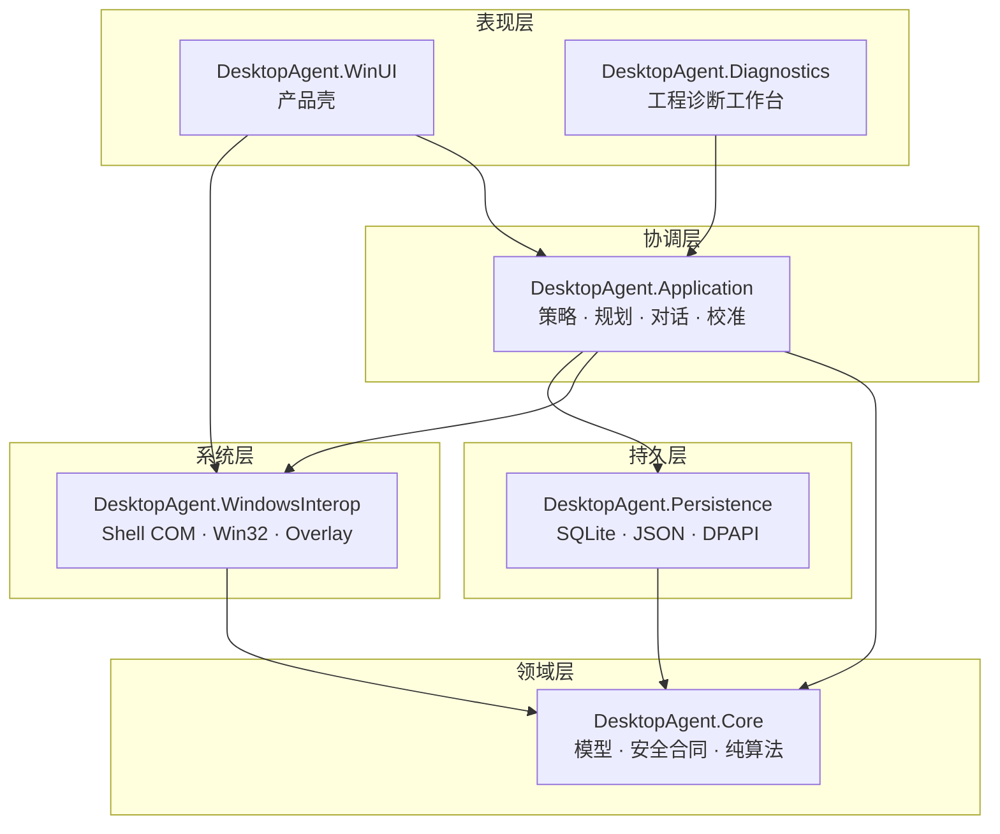
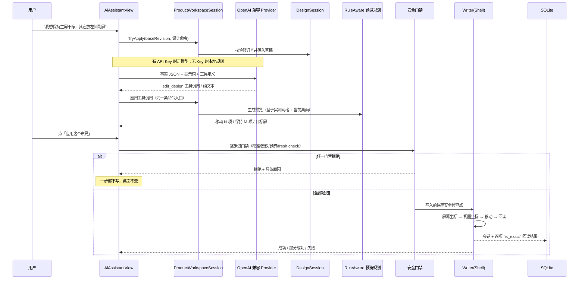
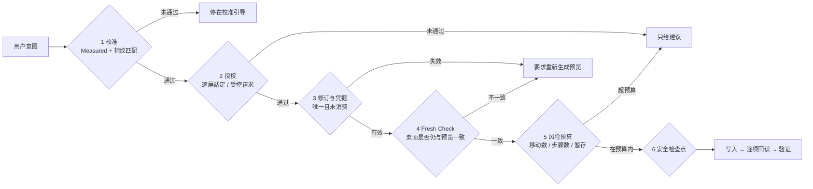

# Tessel 架构与关键实现

面向要改这个仓库的人。**用户说明**见 [README](../README.md)，**踩过的坑**见 [pitfalls.md](pitfalls.md)。

## 一句话架构

Tessel 把「用户的一句话」编译成「一组确定性的图标坐标变更」，中间每一步都可以被拒绝，且拒绝永远是默认结果。



**依赖方向是单向的**：Core 不认识任何人；Application 认识 Core/Persistence/WindowsInterop 的接口；
WindowsInterop 与 Persistence 只依赖 Core 的合同；UI 只依赖 Application。

## 五层各自负责什么

| 层 | 负责 | 明确不负责 |
| --- | --- | --- |
| **Core** | 领域模型、安全合同、纯算法（规则规划、预览、回滚判定） | 任何 I/O、任何 UI、任何 Shell 调用 |
| **Application** | 编排：观察 → 理解 → 设计 → 预览 → 校验 → 执行；策略与门禁 | 直接调用 Win32；直接读写文件 |
| **WindowsInterop** | Explorer 桌面读取与写入、显示器拓扑、坐标换算、分区线框窗口 | 业务判断（该不该写、写到哪由上层决定） |
| **Persistence** | SQLite schema 与迁移、JSON 草稿、DPAPI | 业务规则 |
| **UI** | 呈现与交互；把所有用户动作翻译成 Application 调用 | 绕过任何安全门禁（代码里没有第二条写入路径） |

## 一条贯穿全链的数据流

以「用户在 AI 助手说一句话，最后真的移动了图标」为例：



关键点：**UI 从来没有直接调用 Writer**。对话、卡片按钮、「应用到桌面」最终都收敛到同一个
执行协调器（`TargetDisplayLayoutExecutionCoordinator`），区别只在传入的参数和授权来源。

## 六个核心概念

### 1. 实测事实（Measured Fact）

`DesktopLayouts/Workspaces/Geometry/ExplorerGridMeasurement.cs`

一次「测量」记录的是：每块显示器的网格间距、图标单元格尺寸、原点相位、样本数与证据来源。

```csharp
public enum ExplorerGridEvidenceSource { Measured, Inferred }
```

- `Measured`：每轴至少 3 个主动样本且完全一致 —— 可以授权执行；
- `Inferred`：≥2 个样本 + 60% 共识 —— 只能用于预览与建议，**不能授权写入**。

判定不是"看起来合理"，而是 `CanAuthorizeExecution(fingerprint)`：既要求来源是 `Measured`，
也要求它记录时的拓扑指纹与当前拓扑一致。

> 证据等级映射必须是**显式 switch**。曾经的写法用数值转换，`Inferred=1` 会被当成 `Measured`，
> 属于典型的 fail-open。

### 2. 拓扑指纹（Topology Identity）

`ExplorerGridTopologyIdentity.cs` 把「当前是哪种桌面环境」压成一个哈希：

```text
explorer-topology-v1:SHA256(auto=<自动排列开关>|每屏 DeviceName|Bounds|WorkArea|DpiX|DpiY|IsPrimary)
```

分辨率、缩放、显示器排列、主屏归属任何一项变化，指纹就变，旧的实测事实自动失效。
相位派生值（图标具体落在哪个格）**故意不进指纹**，那不是环境属性。

### 3. 设计会话（Design Session）

`DesktopLayouts/Workspaces/Editing/DesktopWorkspaceDesignSession.cs`

设计不是一段可以直接改的 JSON，而是一串**命令 + 修订号**：

```csharp
TryApply(long baseRevision, IReadOnlyList<DesktopWorkspaceDesignCommand> commands)
    // → Applied | Stale
```

八类命令：增删分区、写摘要、设显示器策略、分配分类、删分类规则、整份替换草稿、替换意图。

- 修订号单调递增，撤销/重做**也**推进修订号（否则"撤销后旧的预览凭据仍然有效"）；
- 模型给的工具调用带 `base_revision`，与当前不符直接拒绝 —— 模型无法基于过期视图改设计；
- 两个编辑器（设计库页面与 AI 对话页）共用**同一个** session 实例，不存在"第二份草稿"。

### 4. 精确预览（Frozen Preview）

预览是一次快照会话：基于当时的桌面观察算出一份**逐项目标坐标**，附带一次性凭据。

- 预览里每一项都有：StableId、当前坐标、目标坐标、所属显示器、是否需要移动；
- 凭据只能用一次，且与「设计修订号 + 桌面指纹」绑定；
- 设计一改，凭据立即作废（`InvalidateDesignRevisionEvidence`）；
- 应用时**不会**复用预览里的写入计划，而是重新 fresh observe + fresh plan，再比对是否仍一致。

### 5. 安全检查点（Safety Snapshot）

每次真实写入前，先把**整个桌面**的图标位置存成一份不可变快照，并记下这次写入的意图。
撤销就是拿这份快照重新生成一份还原计划，走**同一条**执行链。

写入会话带来源标记（`origin`）：`organize`（整理）或 `checkpoint-restore`（还原）。
撤销只认 `organize` 的会话 —— 否则会出现"撤销撤销"的套娃。

### 6. 可达性判定（Apply Readiness）

`DesktopLayouts/Workspaces/DesktopApplyReadiness.cs` 是「现在能不能应用」的**唯一判定处**：

```csharp
DesktopApplyReadiness(CanApply, ButtonText, Reason, Headline, Detail)
```

UI 里所有"能不能点"的地方都读它，不允许各自判断。这条规则来自一个真实问题：
按钮该不该亮，曾经在三个地方各写一份，结果说法互相矛盾。

## 安全链：六道闸



任何一道不过，结果都是"什么都不做 + 说清为什么"。这是刻意的：**宁可整理失败，也不要半途写入**。

## 关键实现细节

### 坐标换算只有一个地方

`src/DesktopAgent.WindowsInterop/DesktopIcons/DesktopViewCoordinateSpace.cs`

Explorer 的 `IFolderView` 用的是**视图客户区坐标**，而产品其余部分全部用**屏幕坐标**。
两者在"主屏不在虚拟桌面左上角"时会差一个偏移量。

```csharp
DesktopViewCoordinateSpace.ClientOrigin   // 视图原点在屏幕坐标系中的位置
.ToScreen(viewPoint)                       // 读：视图 → 屏幕
.ToView(screenPoint)                       // 写：屏幕 → 视图
```

规则：读的时候先 `ToScreen`，写的时候先 `ToView`，写完回读再 `ToScreen` 比对。
**不要在别处再写第二套换算。**

### 对话不是"把 JSON 丢给模型"

`src/DesktopAgent.Application/Intelligence/OpenAiCompatibleWorkspaceChatProvider.cs`

- SSE 流式返回，正文与工具参数共用 512 KiB 上限，传输信封另设 16 MiB 上限；
- 每轮最多 8 个工具调用，单轮命令数 ≥64 拒收；
- `finish_reason` 必须是 `stop` 或 `tool_calls`；
- 工具参数里的 `base_revision` 与 session 当前修订不符 → 直接拒绝整轮；
- 模型**没有**「整份替换设计」的工具（该命令只存在于两条本地路径），最多是逐个分区增删改；
- 没有 API Key 时走本地规则生成器，功能降级但不阻断。

### 撤销复用执行链，不写第二套

`DesktopLayoutRollbackService` 做三件事：只读判定 → 找未收敛现场 → 用同一次 fresh 观察同时
供判定与计划使用。真正的写入仍然交给执行协调器，参数只是换成"还原计划 + `checkpoint-restore`"。

判定条件一条都没松：桌面与那次写入的期望终点不完全一致，就停手并点名是哪些项。

### 数据模型（SQLite）

`src/DesktopAgent.Persistence/Database/SqliteDesktopAgentSchema.cs`，当前 `user_version = 13`。
迁移是**幂等追加**：`EnsureV13Schema` 之类的方法只做 `ALTER TABLE` / `CREATE TABLE IF NOT EXISTS`，
不重建表；测试里有一条专门把库降级到旧版本再升级，验证回填正确。

主表：`desktop_layout_snapshots`、`desktop_layout_recovery_sessions`、`desktop_layout_templates`、
`explorer_grid_measurements`、`explorer_grid_display_authorizations`、`workspace_blueprints` +
`workspace_blueprint_revisions`、`workspace_execution_journals`、`workspace_dynamic_execution_journals`。

不变式：**已提交的会话行不可修改**，只能追加。来源标记 `origin` 在 INSERT 时写入，UPDATE 不碰。

### UI 结构约束

- 三阶段（设备准备 / 编辑模板 / 预览与应用）的可见性由
  `Application/DesktopLayouts/Workspaces/DesktopLayoutStagePresentation.cs` 的 `ElementOwners` 表决定，
  有契约测试逐个核对 —— 不允许在 XAML 里各自写 `Visibility`；
- 冻结预览期间"能不能操作"是分级的：线框可开关、设计不可编辑，不是一个布尔量；
- 聊天消息渲染到原生控件（`ChatMarkdownRenderer`），HTML 标签降级为纯文本，图片不加载，外链只放行
  http/https。

## 为什么这样设计

一句话：**桌面写入是不可撤销的物理后果**。

误点一次「应用」，四十个图标会在你眼前跳走。所以每一层都按"这个决定可能错"来写：

- 事实绑定环境（拓扑指纹），不绑定"上次测得"；
- 授权来自具体的一次站定，不是一次勾选；
- 凭据一次性、绑定修订号，过期就重来；
- 写入前留检查点，写入后逐项回读；
- 任何不确定 → 停下来说清楚，而不是"尽力而为"。

代价是步骤多、用户要多点几下。这是刻意的取舍。
