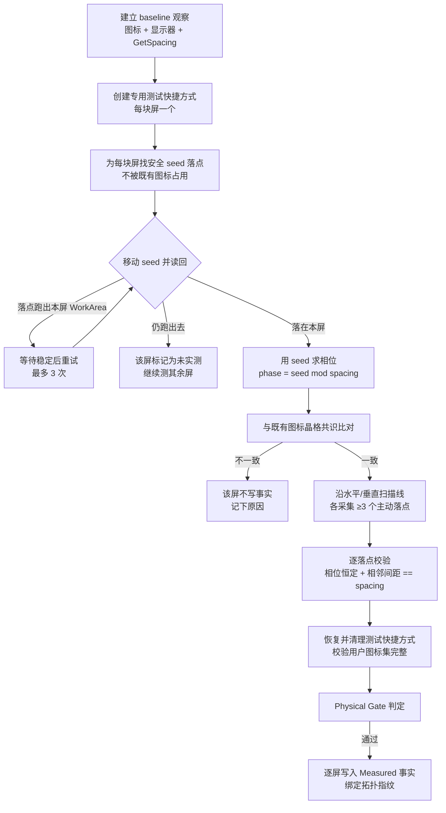

# 桌面网格识别：从「差一格」到可复现的实测

这是整个项目最难、也最值得写下来的一块。**桌面不是自由画布**，它是一张有隐藏原点的网格；
而这张网格的原点，Windows 没有任何 API 告诉你。

如果你只想记住一句话：**间距可以问，原点只能测，而"测到了"必须同时被两种独立证据支持。**

---

## 一、问题：桌面图标到底在哪

### Explorer 的桌面是一张网格

桌面图标的"位置"不是一个连续坐标，而是槽位索引映射成像素：

```text
像素 = 网格原点(GridOrigin) + 列号 × 步长X,  行号 × 步长Y
```

三个量决定了整张网格：

| 量 | 含义 | 能直接读吗 |
| --- | --- | --- |
| **步长 spacing** | 相邻两个图标槽位的像素距离（如 `(76, 98)`） | ✅ `IFolderView2.GetSpacing` |
| **相位 phase** | 网格原点在绝对坐标下的余数（如 `(62, 2)`） | ❌ **没有任何 API** |
| **工作区 WorkArea** | 这块屏可用于摆放的区域（扣掉任务栏） | ✅ `DisplayDescriptor.WorkArea` |

代码里 `IFolderView2.GetSpacing` 与 `GetAutoArrange` 的读取在
`src/DesktopAgent.WindowsInterop/DesktopIcons/DesktopShellIconPositioningCapabilitiesReader.cs`。
注意 `GetAutoArrange` 返回的是 **0 = 开启 / 1 = 关闭**，和其它 COM 布尔约定相反，写反了会在
静默中破坏所有布局。

### 为什么差一格

只要相位错了，**每一个**目标坐标都会落到相邻槽位上。用户看到的是"图标整体挪了一格"，
而你算出来的布局从第一项开始就是错的。

更麻烦的是它**在默认环境下看不出来**：单屏、或者主屏恰好在虚拟桌面 `(0,0)` 时，相位往往
是 `(0,0)`，任何"假装相位是 0"的实现都能跑通。等真的接上多屏，问题才暴露。

### 为什么不能"推断"一下

三条都试过，都不行：

1. **读注册表 `IconSpacing`** —— 拿到的是用户设置的逻辑值，不保证与实际渲染一致
   （DPI 缩放、每屏不同的 WorkArea、主题都会影响实际落点）。
2. **用图标当前位置求 GCD / 取模投票** —— 用户手动拖过的图标根本不在格点上。
   （这正是我们后来把它降级为"佐证"而不是"主证据"的原因。）
3. **屏幕上任意点吸到最近的网格** —— 假设原点在 `(0,0)`，等于赌相位为零。三屏环境下赌输。

---

## 二、解法：主动探测（Physical Probe）

既然原点读不到，就只能**动手测**：放一个自己可控的图标进去，看它真的落在哪个像素。

核心实现：`src/DesktopAgent.WindowsInterop/ExplorerGridPhysicalProbe/ExplorerGridPhysicalProbeRunner.cs`
（1460 行）、探测计划 `ExplorerGridProbePlan.cs`、事实写入 `ExplorerGridProbeFactRecorder.cs`。



### 1. 每块屏一个探针

给每块显示器**各创建一个专用测试快捷方式**（`.url`/`.lnk`，由
`DesktopInternetShortcutStore.cs` 生成），它在该屏的落点就是这块屏的"探针"。

用每屏一个而不是一个跑遍全场，是因为 Explorer 的槽位分配是**按屏**的，跨屏移动会被系统
重新摆位（见下面「踩坑」）。

### 2. 先找安全 seed

`FindSafeSeedRequest` 会在目标屏上找一个**不被任何既有图标占用**的槽位当起点。如果起点本身
压在用户图标上，测出来的落点是"两个图标抢一个槽位"后的结果，不能用于反解网格。

### 3. 移动 → 等落定 → 读回真实坐标

```csharp
var seed = (await ExecuteMoveAsync(..., kind: ExplorerGridProbeMoveKind.Seed, ...)).Observed;
```

关键在"等落定"：写完立即读会读到中间状态。代码里有
`SettledObservationAttempts = 24`、`ShortcutObservationAttempts = 20` 的重试预算，
每次都要等到桌面观察**连续稳定**为止。

### 4. 相位 = 落点对步长取模

```csharp
var phase = ExplorerGridProbePlan.PhaseOf(seed, spacing);   // (x mod spacingX, y mod spacingY)
```

### 5. 三个方向的样本

`ExplorerGridProbePlan.Create` 在目标屏上选一条**水平扫描线**和一条**垂直扫描线**，各取
≥3 个连续空闲槽位（`PreferredMinimumActiveSamplesPerAxis = 3`），外加对角验证。

然后逐个落点做三件事：

| 校验 | 方法 | 目的 |
| --- | --- | --- |
| 相位恒定 | `EnsurePhase` | 每个落点的余数必须相同 —— 否则说明中间有东西吸附了 |
| 间距恒定 | `EnsureHorizontalSpacing` / `EnsureVerticalSpacing` | 相邻落点距离必须正好等于 `spacing` |
| 落点空闲 | `EnsureLandingSlotFree` | 目标槽位在移动前必须没被占用 |

**"每轴至少 3 个主动样本"不是随手定的**：1 个样本只能说明"某点在某处"；2 个能定方向；
3 个才能排除"刚好被吸附到另一个晶格"。

### 6. 收尾：恢复与完整性校验

探测会动用户桌面，所以每一步都有代价保护：

- 恢复/删除所有探针快捷方式（`RestoreOwnedShortcutsAsync`）；
- 校验用户图标集**一个不少**（`DiffUserIcons` → `Displaced` / `Missing` / `Extra`，任一非零即中止）；
- 校验拓扑在测量期间没变（`EnsureTopologyUnchanged`）——测量中途插了一块屏，结果作废。

---

## 三、双证据：探针落点 vs 既有图标晶格

这是整套方案里最关键的一个判断，也是最容易被忽略的。

光有探针落点是不够的：探针是一个**刚被创建的新图标**，Explorer 可能把它放到一个"自己的"
晶格里，而用户原有的那批图标并不在这个晶格上。

所以每次都要做第二份证据 —— **既有图标晶格共识**：

```csharp
// ExplorerGridPhysicalProbeRunner.ComputeIconLatticeConsensus
var positions = baseline.Icons
    .Where(icon => !expectedProbePositions.ContainsKey(icon.StableId))   // 排除探针本身
    .Where(icon => display.WorkArea.Contains(icon.PixelPosition))        // 只看本屏
    .Select(icon => icon.PixelPosition)
    .ToArray();
var inference = DesktopExplorerGridPhaseResolver.TryInfer(positions, spacing);
```

`DesktopExplorerGridPhaseResolver` 的做法：统计每个图标位置的
`(x mod spacingX, y mod spacingY)` 二元组，取**众数**；只有当众数占比 ≥ 60%
（`minimumConsensusRatio`）时才认定可信。

两份证据必须**一致**：

```csharp
if (consensus.IsReliable && consensus.Phase != phase)
{
    // 该屏不写事实，继续测其余屏
}
```

### 真机案例：DISPLAY3 的两种晶格

2026-10-14 真机：`DISPLAY3` 的探针落点推断出相位 `(2, 16)`，但该屏 **46/48 个既有图标**
落在 `(35, 84)` 晶格上。两者相差**不是步长的整数倍** —— 说明探针被放到了另一张晶格。

如果只信探针，我们就会写出一个让所有布局预测都算错用户图标位置的"事实"。
所以这一屏**不写事实**，只记录原因。

### 由此确立的规则

> **事实逐屏写入；测不到的屏不写、不猜、不降级。**
> 降级是策略层的决定（用 `Inferred` 参与预览），不是探测器的决定。

---

## 四、事实的形态与写入门槛

`ExplorerGridMeasurement`（`src/DesktopAgent.Core/DesktopLayouts/Workspaces/Geometry/ExplorerGridMeasurement.cs`）：

| 字段 | 作用 |
| --- | --- |
| `EvidenceSource` | `Measured` / `Inferred` —— 决定能不能授权写入 |
| `DeviceName` + `Spacing` + `Phase` | 事实本体 |
| `ActiveSampleCount` / `ConsensusCount` | 样本数（被动样本不能凑数） |
| `SpacingConstant` / `PhaseConstant` | 测量过程中是否恒定 |
| `TopologyIdentity` | 环境指纹（绑定证据与环境的唯一纽带） |
| `RecordedAtUtc` | 单调失效水位用 |

写入门槛在 `ExplorerGridProbeFactRecorder.BuildFacts`，逐条落地：

```text
Status ∈ { Passed, Partial }            // Physical Gate 通过
TopologyIdentity 非空                    // 否则事实无法绑定环境
SharedSpacing == true                    // 三屏步长一致，才能共用一套换算
PhaseVerifiedPerDisplay == true          // 相位逐屏校验通过（不要求跨屏相同）
每屏: IsMeasured && SpacingConstant && PhaseConstant
每屏: ActiveHorizontal ≥ 3 && ActiveVertical ≥ 3
```

任一条不过 → **该屏不写**，并把原因写进 `Rejections`。

### 为什么相位必须逐屏校验、不能跨屏比较

因为相位是**每块屏各自工作区原点**的属性。任务栏只占一块屏时，三块屏的绝对相位本来就不相同：

```text
真机实测：DISPLAY1 phase = (2, 16)，DISPLAY3 phase = (35, 84)
```

早期实现要求"三屏相位相同"，结果三屏环境下永远测不出结果。

---

## 五、从事实到坐标：网格原点怎么算

事实是 `(spacing, phase)`，而布局需要的是**网格原点的绝对坐标**：

```csharp
// DesktopExplorerWorkspaceGeometryAdapter.cs:334
GridOrigin = (
    AlignUpToPhase(WorkArea.Left, spacing.X, phase.X),
    AlignUpToPhase(WorkArea.Top,  spacing.Y, phase.Y));
```

`AlignUpToPhase` 把工作区左上角**向上取整**到最近的、余数等于 phase 的点：

```csharp
var residue = PositiveModulo(value, spacing);
var delta   = (phase - residue + spacing) % spacing;
return value + delta;
```

`ExplorerDisplayGeometry` 的构造函数里还有一条不变式，把错误挡在源头：

```csharp
if (PositiveModulo(gridOrigin.X, spacing.X) != phase.X || ...)
    throw new ArgumentException("GridOrigin 必须与 Explorer phase 对齐。");
```

有了 `GridOrigin` + `Spacing` + `Columns/Rows`，槽位与像素的互转就成立了
（`ExplorerGridPresentation.PixelBounds` / `Quantize` / `Relative`）：

```text
列号 = round((像素X - GridOrigin.X) / Spacing.X)
像素X = GridOrigin.X + 列号 × Spacing.X
```

之后所有分区、预览、线框、写入，全部走这一套投影 —— **不允许第二套**。

---

## 六、从事实到环境：拓扑指纹

`ExplorerGridTopologyIdentity` 把「现在是哪种桌面环境」压成哈希：

```text
explorer-topology-v1:SHA256(auto=<自动排列>|每屏 DeviceName|Bounds|WorkArea|DpiX|DpiY|IsPrimary)
```

刻意**排除** phase、GridOrigin、BlockedSlotIds —— 它们是从环境派生的量，放进去会让指纹
在"图标挪了一下"时也变化，变成恒假。

事实绑定指纹后：

- 分辨率 / 缩放 / 排列 / 主屏归属变化 → 指纹变 → 旧事实自动失效；
- 图标位置变化 → 指纹不变 → 事实继续有效（这是对的，位置不是环境属性）。

---

## 七、产品侧：校准门

`src/DesktopAgent.Application/DesktopLayouts/Workspaces/Geometry/DesktopGridCalibration.cs`

```text
逐屏: measurement.CanAuthorizeExecution(topologyIdentity)     // 必须是 Measured 且指纹匹配
逐屏: fact.Spacing == observation.PositioningCapabilities.Spacing   // 事实与实时读取一致
整体: geometryAdapter 报告的所有屏都是 Measured
未配置校准器 → 直接 fail-closed
```

再加两道运行期保护：

- `RequireMeasurementsAfter(DateTimeOffset)` —— **单调失效水位**（`Interlocked`），
  在内存里先让旧事实失效，再持久化，避免"刚失效的瞬间被另一个线程读到"；
- 未 Ready 时观测源直接返回 `Unavailable(CalibrationRequired)`，上层拿不到可用几何。

环境变化信号来自 `TrayIconHost` 的 WndProc：`WM_DISPLAYCHANGE` / `WM_SETTINGCHANGE` /
`WM_DPICHANGED` / `TaskbarCreated`，只投递事件、不在系统消息栈里做重活，随后
`DispatcherQueue.TryEnqueue` 异步核验。

---

## 八、真机上踩到的四件事

### 1. 探针被系统摆到别的屏

```text
DISPLAY2 请求 seed (-540, 730) → 落点却是 DISPLAY1 的 (2, 702)
```

快捷方式刚创建时，Explorer 会把它当"新项目"再摆一次位。处理方式：先等它稳定，把同一个图标
挪回去重试（最多 3 次）；仍失败就判定"这块屏测不到"，跳过它继续测其余屏 ——
而不是中止整轮、也不是硬编一个相位。

### 2. 坐标空间不是一套

`IFolderView.GetItemPosition` 返回的是**视图客户区坐标**（原点在虚拟桌面左上角），
而 WorkArea、Bounds、鼠标事件用的是**屏幕坐标**。主屏不在虚拟桌面 `(0,0)` 时两者差一个偏移。

这曾在真机上表现为"所有图标整体偏移一格"，排查过程见 [pitfalls.md · A1](pitfalls.md)。
解法是唯一换算点 `DesktopViewCoordinateSpace`（`ToScreen` / `ToView`）。

### 3. 自动排列会改写你刚写下的坐标

`GetAutoArrange` 为开启时，Explorer 会把任何目标位置吸附到它自己的全局网格，
`SelectAndPositionItems` 返回成功但实际位置不同。所以写入后**必须回读比对**，
不能信写入返回值。

### 4. 「间距共享」要单独验

三块屏的步长在真机上是相同的（`SharedSpacing = true`），但这件事不能假定 ——
`publish` 前的探测会显式校验 `report.SharedSpacing`，不通过就不写事实。

---

## 九、这套方案换来了什么

| 没有实测时 | 有实测后 |
| --- | --- |
| 相位靠猜（假定 0），多屏下整体偏移一格 | 每屏实测相位，误差为 0 像素 |
| 换分辨率后旧结论继续用，静默出错 | 拓扑指纹不匹配 → 自动失效 → 回到校准 |
| 推断和实测混用，误判为"有依据" | 显式枚举 + 显式 switch，`Inferred` 永远不能授权写入 |
| 某块屏测不准就中止整轮 | 逐屏写入，测不到的屏由策略层拒绝执行 |
| 不知道测试动过桌面没有 | 每个探针都恢复、删除，并校验用户图标集完整 |

代价是校准要几十秒、要动一次桌面、要用户单独确认。这是刻意的：**宁可慢一次，也不要长期错**。

---

## 相关代码索引

| 文件 | 职责 |
| --- | --- |
| `src/DesktopAgent.WindowsInterop/ExplorerGridPhysicalProbe/ExplorerGridPhysicalProbeRunner.cs` | 探测主流程（seed、扫描、校验、恢复） |
| `.../ExplorerGridProbePlan.cs` | 扫描线与槽位选择策略 |
| `.../ExplorerGridProbeFactRecorder.cs` | Physical Gate 判定与事实写入门槛 |
| `.../DesktopInternetShortcutStore.cs` | 创建/清理专用测试快捷方式 |
| `src/DesktopAgent.Core/DesktopLayouts/Templates/Resolution/DesktopExplorerGridPhaseResolver.cs` | 既有图标晶格共识推断 |
| `src/DesktopAgent.Core/DesktopLayouts/Workspaces/Geometry/ExplorerGridMeasurement.cs` | 事实模型与授权判定 |
| `.../ExplorerGridTopologyIdentity.cs` | 拓扑指纹 |
| `.../ExplorerGridPresentation.cs` | 槽位 ↔ 像素投影 |
| `src/DesktopAgent.Application/DesktopLayouts/Workspaces/Geometry/DesktopGridCalibration.cs` | 产品侧校准门 |
| `src/DesktopAgent.WindowsInterop/DesktopIcons/DesktopViewCoordinateSpace.cs` | 视图坐标 ↔ 屏幕坐标 |
| `src/DesktopAgent.WinUI/LayoutManagementView.GridProbe.cs` | 产品内一键校准入口 |
